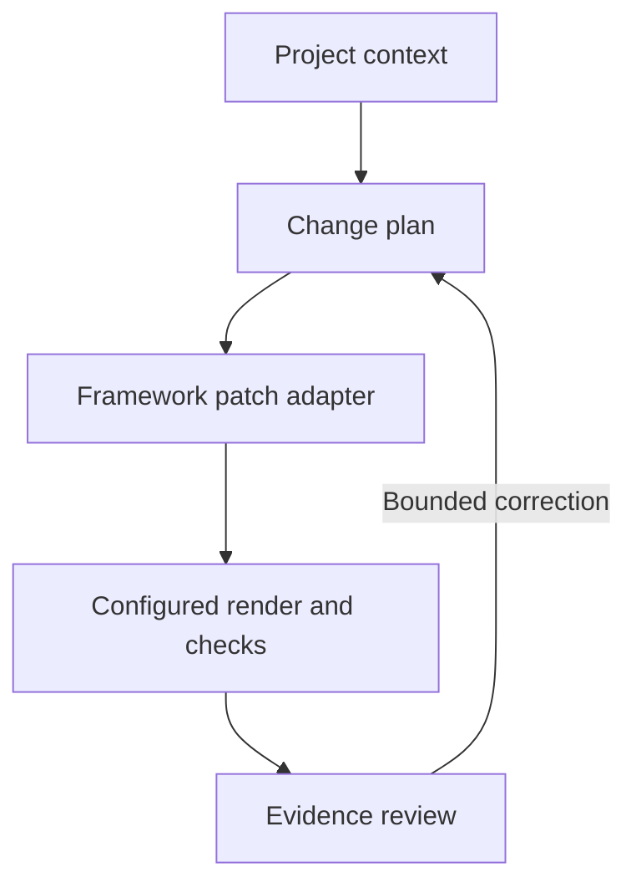

# Context-Aware UI Collaboration — Proposed Architecture

[繁體中文版本](README.zh-TW.md)

Status: **proposal with a bounded read-only inspector**, associated with PR #9 and roadmap Issue #8. `scripts/inspect_project_profile.py` reads static manifests and source candidates. It does not execute project configuration, resolve semantic tokens, confirm component APIs or state ownership, apply patches, render the application, or verify runtime behavior. No patch engine, state generator, visual repair agent, or runtime renderer is shipped here.

## Decision and scope

Evolve the optional integration layer toward a context-aware UI collaborator: a requested UI change should fit the target project's design system, component APIs, state ownership, data flow, and runtime constraints, and leave reviewable evidence.

The current repository already provides a redesign methodology. The next step is to connect that methodology to existing code through explicit contracts. Keep the concise, portable core intact while these integration contracts are explored; future core behavior changes require a versioned decision and evaluation review.

Use Vue 3 as the first implementation target. React and Svelte are future adapters; support for them requires independent fixtures and adapter evidence. Sharing a plan format does not establish implementation compatibility.

## Architecture boundaries

| Layer | Responsibility | Output |
|---|---|---|
| Portable methodology | Goals, content coverage, IA, reuse decisions and component responsibilities | Existing design artifacts |
| Project context | Inspect the relevant workspace, conventions, tokens, components and state/API owners | Versioned project profile with source references |
| Change planning | Map user intent to reusable components, applicable states and explicit edit boundaries | Reviewable change plan |
| Framework adapter | Parse supported syntax and propose bounded, revision-checked edits | Patch plus validation requirements |
| Evidence runner | Exercise configured states/conditions and preserve observations | Captures, measurements, failures and unrun conditions |
| Host integration | Expose scoped operations and optionally render a declarative UI specification | Host-controlled tools and temporary surfaces |

The framework parser, command execution, image review, MCP transport, and runtime renderer are optional capabilities. Discover them separately; do not infer one from the presence of another.

## Design-time flow

No screenshot is required to make a useful plan. Any claim that the result is rendered, measured, or visually reviewed requires evidence from the corresponding capability. Runtime UI follows a separate host-controlled path described in the [runtime contract](../runtime-ui/README.md).

## Five capability contracts

| Capability | Required behavior | Rejection or stopping condition | Implementation evidence |
|---|---|---|---|
| Design-system awareness | Resolve semantic intent to observed tokens and existing components | Missing role, unresolved theme/import, or ambiguous alias | Source-to-consumer map, rendered token resolution and scoped drift report |
| AST-guided edits | Parse, identify one supported target, preserve boundaries and re-check the revision | Stale file, ambiguous target, unsupported syntax or unsafe binding collision | Minimal diff, idempotence, protected-region checks and behavior regression |
| State coverage | Model applicable loading, empty, error and success behavior with transitions | Unknown state owner, API/error semantics or unsafe retry | Transition and interaction evidence, including cancellation and stale responses |
| Responsive repair | Inspect a declared condition matrix and rerun it after bounded fixes | Budget exhausted, oscillation, new regression or missing runtime | Before/after captures, deterministic results and remaining gaps |
| Dynamic UI | Return a validated declarative tree using registered components and actions | Unknown type/action, stale schema, invalid data or unavailable model | Host-side validation, accessible fallback and bounded lifecycle |

Detailed contracts:

- [Project profile and token mapping](project-profile.md)
- [State transitions and ownership](state-contract.md)
- [AST patching](../ast-patching/README.md)
- [Rendered visual validation](../visual-validation/README.md)
- [Dynamic UI](../runtime-ui/README.md)
- [Vue/Tauri mapping](../vue3-tauri/README.md)
- [MCP operation boundary](../mcp-server/README.md)

## Minimal artifact chain

These are proposed logical records, not implemented JSON schemas. Keep them small and scoped to the task; do not serialize the entire repository or process environment.

| Record | Minimum fields | Freshness and reuse rule |
|---|---|---|
| Project profile | profile version, source revision/file digests, task scope, stack, alias evidence, component/token references, state/API owners, capabilities, unknowns | Refresh affected entries when their source files change; distinguish stale from unknown |
| Change plan | profile identifier, target paths, semantic intent, reuse decision, state contract, public API changes, protected regions, proposed edits, required checks | Invalidate on changed target content or context dependencies |
| Patch proposal | plan identifier, original file digests, operation identifiers, target nodes/ranges, diff, unsupported conditions | Re-check content before applying; show conflicts instead of rebasing edits blindly |
| State map | owner, initial state, events/guards, side effects, applicable presentation, recovery and concurrency rules | Remains consistent with the actual store/composable/service contract |
| Validation report | source revision, case/condition IDs, data fixture, runtime, method, measured result, artifacts, reviewer, unrun conditions, correction history | Evidence belongs to its recorded revision; a code change makes affected earlier passes stale |

For each operation, report applicable capability, result (`passed`, `failed`, `not run`, `unsupported`, or `blocked`), evidence references and unresolved questions. A successful plan or parse is not a successful implementation.

## State and API ownership

Inspect the existing store/composable/service boundary before adding state or calls. Components should reuse the project's established action and error contracts. Record request/response shape, cancellation, error codes, retry semantics, and any persistence or native command involved.

For an editor, keep media decoding, FFmpeg calls, file permissions, and timeline persistence owned by their established services. An interaction change must identify those boundaries and verify affected behavior. Preserving the text of a service call does not prove that its timing, arguments, or surrounding state remain correct.

## Delivery sequence

1. **P0 — context and design-system fit:** read-only profile, semantic token mapping and component reuse on a synthetic Vue specimen.
2. **P0 — bounded edits:** one Vue AST operation with stale-file refusal, idempotence and explicit business-logic regression evidence.
3. **P0 — applicable states:** media-library fixture using an existing state owner, complete transitions and recoverable failures.
4. **P1 — rendered repair:** build on the dashboard specimen in Issue #7, define a multi-condition baseline and bounded correction policy.
5. **P2 — host/runtime experiment:** render one validated troubleshooting panel with registered actions and a static fallback, then evaluate another framework adapter.

| Priority | Work item | Dependency |
|---|---|---|
| P0 | [#11](https://github.com/bynanci/website-design-skill/issues/11) Project profile, token map and component reuse | Existing specimen/contracts in PR #5 and Issue #7 |
| P0 | [#12](https://github.com/bynanci/website-design-skill/issues/12) Bounded Vue patch pilot | [#11](https://github.com/bynanci/website-design-skill/issues/11) |
| P0 | [#13](https://github.com/bynanci/website-design-skill/issues/13) Media-library transitions | [#11](https://github.com/bynanci/website-design-skill/issues/11); use [#12](https://github.com/bynanci/website-design-skill/issues/12) for adapter-driven edits |
| P1 | [#14](https://github.com/bynanci/website-design-skill/issues/14) Multi-condition repair | Issue #7, [#11](https://github.com/bynanci/website-design-skill/issues/11), [#12](https://github.com/bynanci/website-design-skill/issues/12) and [#13](https://github.com/bynanci/website-design-skill/issues/13) |
| P2 | [#15](https://github.com/bynanci/website-design-skill/issues/15) Declarative troubleshooting panel | [#11](https://github.com/bynanci/website-design-skill/issues/11) and [#13](https://github.com/bynanci/website-design-skill/issues/13); separate from AST source editing |

All five implementation issues remain open; this document specifies their contract.

The v0.1 release evidence in Issue #1 and v0.2 pilot/specimen work in PR #5 / Issues #6–#7 remain their own gates. Exploration can proceed on an opt-in branch; it does not satisfy those gates or imply a tagged release.

## Success measures

Evaluate the acceptance fixture at a pinned revision. Report unsupported cases and failures alongside passes:

- token mappings resolve in each declared theme and introduce no unapproved design values in the changed scope;
- chosen existing components and state owners are preserved, or changes are explicitly justified;
- edits are minimal, idempotent and rejected on a stale or ambiguous target;
- affected API calls, events and state transitions retain their contract;
- required responsive/interaction cases pass, with unrun cases visible;
- repair iterations, latency and resource cost stay within the declared budget;
- runtime UI rejects unsupported input and offers an actionable fallback.

Avoid promises of perfect theme fit, universal framework support, unchanged business behavior, or flawless screens before those conditions are demonstrated.
